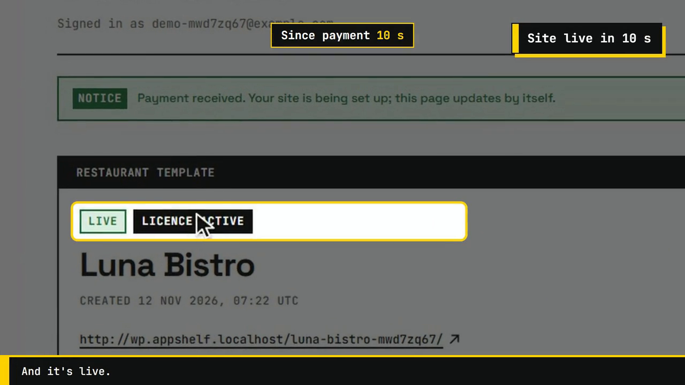
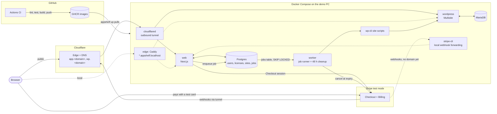

> **Personal demo project.** Payments run in Stripe test mode only, and every site deletes itself after 48 hours.

# AppShelf

AppShelf is a small SaaS that sells licensed apps. The first product type is a
hosted WordPress site: you pick a template (restaurant, agency or services),
pay with a Stripe test card, and a few seconds later you get your own site on a
shared WordPress Multisite network, with an admin login. Cancel the plan and the
site is archived; renew it and the site comes back. After 48 hours the site and
its subscription are removed, so the demo cleans up after itself.

The whole stack runs with Docker Compose on one machine and is switched on only
for demos. A Cloudflare Tunnel makes it public without opening any port.

## Demo video

[](showcase/media/appshelf-demo.mp4)

A 63-second narrated walkthrough of the running app, with subtitles
([`appshelf-demo.vtt`](showcase/media/appshelf-demo.vtt)). It covers signing up,
picking a template and paying with the Stripe test card. The site goes live
10 seconds after the payment. Then the plan is cancelled (the site is archived)
and renewed (the site is back online).

[`scripts/record-demo.mjs`](scripts/record-demo.mjs) records the real flow with a
visible cursor and page wipes. It fast-forwards typing, page loads and
provisioning, with an on-screen timer. The zooms, spotlights, callouts and
title/end cards are a HyperFrames composition in
[`showcase/media/edit`](showcase/media/edit). The English voice-over is
generated locally with Kokoro TTS. The background music is synthesised by
[`showcase/media/music/generate-bed.py`](showcase/media/music/generate-bed.py)
and ducked under the voice. Sources and licences are listed in
[`showcase/media/CREDITS.md`](showcase/media/CREDITS.md).

## Architecture



| Part | Path | What it does |
|---|---|---|
| Web app | `apps/web` | Sign-up, catalogue, Stripe Checkout, webhook, dashboard (cancel, renew) |
| Database package | `packages/db` | Drizzle schema, SQL migrations, typed client, job queue helpers |
| Worker | `apps/worker` | Polls the `jobs` table, runs the WordPress scripts, deletes expired sites |
| WordPress | `wordpress` | Multisite image, three block themes, site create/archive/delete scripts |
| Infrastructure | `infra`, `scripts`, `.github` | Compose overrides, Cloudflare tunnel, `appshelf` CLI, CI/CD |

The contract between these parts (services, environment, schema, scripts, job
rules) is [docs/contracts.md](docs/contracts.md).

## Lifecycle

1. **Buy.** Checkout completes, Stripe sends `checkout.session.completed`. The
   web app records the subscription, creates an `active` license and a
   `pending` site that expires 48 hours later, and queues `site.provision`.
   The worker creates the site with wp-cli and the dashboard shows its URL and
   a one-time admin password.
2. **Cancel.** "Cancel plan" cancels the Stripe subscription at once. The
   license turns `inactive` and the worker archives the site.
3. **Renew.** Before the site expires, "Renew" opens a new Checkout session.
   When it completes, the license is `active` again and the worker unarchives
   the site.
4. **Delete after 48 hours.** Every 5 minutes the worker queues `site.delete`
   for expired sites, cancels any subscription that is still active and turns
   the license `inactive`.

Jobs are rows in Postgres, claimed with `SELECT ... FOR UPDATE SKIP LOCKED`,
retried with exponential backoff and marked `failed` after five attempts.
Webhook handling is idempotent (`stripe_events`).

## Data model

| Table | Holds |
|---|---|
| `users`, `sessions` | Accounts (email + argon2 hash) and hashed session tokens |
| `products` | What is for sale, with its Stripe product and price. `type` is `wordpress_site` or `plugin` |
| `subscriptions` | Mirror of the Stripe subscription and its status |
| `licenses` | A user's right to a product: `active` or `inactive`, plus `license_key` and `max_activations` |
| `sites` | The WordPress site behind a license: template, slug, blog id, status, `expires_at` |
| `jobs` | Work for the worker: `site.provision`, `site.archive`, `site.unarchive`, `site.delete` |
| `stripe_events` | Processed webhook event ids |

`products.type` already accepts `plugin`, and `licenses` already has
`license_key` and `max_activations`, so selling plugins with license keys means
adding product rows and code, not a migration.

## Run it locally

Needs Docker Desktop and PowerShell 7. Put your Stripe **test** keys
(`STRIPE_SECRET_KEY=sk_test_...`, `STRIPE_PUBLISHABLE_KEY=pk_test_...`) and,
for going public, `CLOUDFLARE_API_TOKEN`, `CLOUDFLARE_ACCOUNT_ID` and `CF_ZONE`
in `.env.local` at the repository root. It is gitignored.

```bash
pwsh scripts/appshelf.ps1 up
```

`up` creates `.secrets.local` with random database and admin passwords on the
first run, pulls the published images from GHCR and starts everything in the
background. Then open:

- http://app.appshelf.localhost for the store,
- http://wp.appshelf.localhost/restaurant-demo/ (also `agency-demo`, `services-demo`) for the showcase sites.

Without a public URL, the `stripe-cli` container forwards Stripe test webhooks
to the web app. Pay with the card `4242 4242 4242 4242`, any future date, any CVC.

| Command | Does |
|---|---|
| `up` | Pull the GHCR images and start the stack |
| `up --build` | Build the images from this checkout instead of pulling them |
| `down` | Stop and remove the containers; data volumes stay |
| `ps`, `logs [service]` | Status and logs |
| `init` | Only create `.secrets.local` |
| `tunnel` | Set up the Cloudflare tunnel, DNS and the Stripe webhook (below) |
| `set-domain` | Move the WordPress network to the public domain, with a backup first |
| `dc <args>` | Any other `docker compose` command with the same files |

No container restarts on its own, so nothing starts with Docker Desktop.
Set `APPSHELF_IMAGE_TAG` to a commit SHA to run an older build. From a git
worktree, set `APPSHELF_SECRETS_DIR` to the main checkout so its secret files
are used.

## Go public

AppShelf goes public through a remotely-managed Cloudflare Tunnel, so the PC
opens no inbound port. It needs a domain on your Cloudflare account.

```bash
pwsh scripts/appshelf.ps1 tunnel
```

1. Creates the tunnel `appshelf`, or reuses it.
2. With `CF_ZONE` empty, it stops here and explains that a domain is needed.
   The stack keeps working on `*.appshelf.localhost`.
3. With `CF_ZONE=example.com`, it routes `app.example.com` to the web app and
   `wp.example.com` to WordPress, creates proxied CNAME records to the tunnel,
   creates (or updates) a Stripe test webhook for
   `https://app.example.com/api/stripe/webhook`, and stores the tunnel token,
   webhook secret and public URLs in `.secrets.local`. It never prints them.

Then move the WordPress network to the new domain and restart:

```bash
pwsh scripts/appshelf.ps1 set-domain
```

```bash
pwsh scripts/appshelf.ps1 up
```

`set-domain` writes a `mysqldump` backup to `backups/` (gitignored), then
updates `wp_site` and `wp_blogs` and runs `wp search-replace --network` for
every stored URL, then points the site links in the app database
(`sites.url`) at the new domain. Running it again changes nothing. Once the tunnel token
exists, `up` also starts `cloudflared` and no longer starts `stripe-cli`.

## CI/CD

[`.github/workflows/ci.yml`](.github/workflows/ci.yml) runs on every pull
request and every push to `main`:

- `npm ci`, lint, typecheck and tests (against a Postgres 17 service container);
- shellcheck on the WordPress scripts, actionlint, and `docker compose config`
  for every file combination the CLI uses;
- Docker builds of `web`, `wordpress` and `worker` with Buildx and the GitHub
  Actions cache, driven by the compose files and
  [`infra/docker-bake.hcl`](infra/docker-bake.hcl).

On `main` it also pushes `ghcr.io/thuane3691/appshelf-web`, `-wordpress` and
`-worker`, tagged `latest` and the commit SHA. `appshelf up` on the demo PC
pulls those images, so deploying is: merge, wait for CI, run `up`.

## Limitations

- One machine, one Multisite network, no backups beyond the dump `set-domain` takes.
- Stripe test mode only: the code refuses a secret key that is not `sk_test_`.
- Sites are deliberately short-lived (48 hours) and the admin password is shown once.
- The stack is online only while the demo PC runs it.
- No outgoing email: sign-up is email + password without verification.

## Release 2

- PayPal as a second payment method.
- WordPress plugins as a product type, with license keys and activation limits.
- An admin panel for products, users, licenses and failed jobs.
